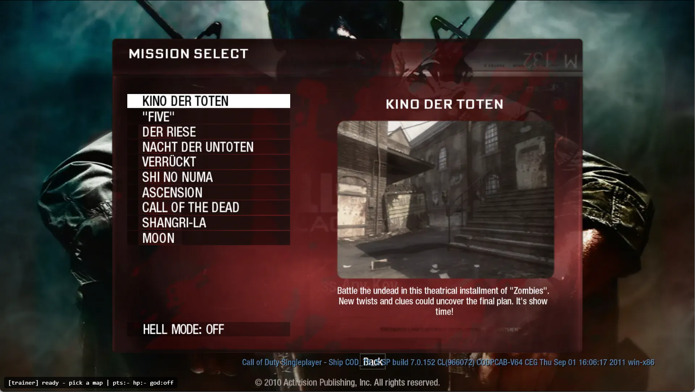
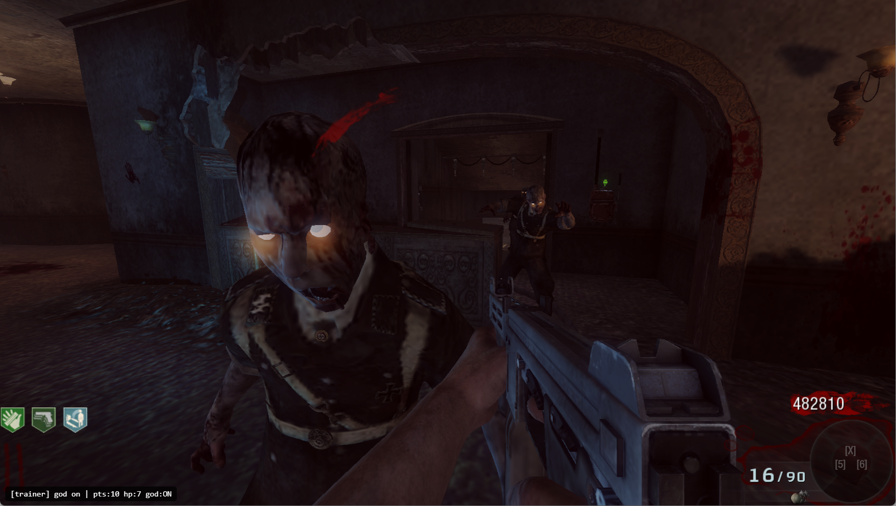

# BO1Z web trainer

A userscript for the BO1 Zombies web port at `https://vel.gg/bo1z`. It finds your points and health in the game's memory and changes them, using hotkeys. It's meant for solo games only.

## Install (Brave or another Chromium-based browser)

1. Install **Violentmonkey** or **Tampermonkey** from the Chrome Web Store.
2. Open `brave://extensions`, go to the extension's **Details** and turn on **Allow User Scripts**. Without this the script won't run.
3. Click **[Install the script](https://github.com/hamshub/bo1z-web-trainer/raw/main/bo1z-trainer.user.js)**. The extension opens an install page; click **Install**. It checks this repo for updates automatically.
4. Open `https://vel.gg/bo1z`. A `[trainer] ready` line in the bottom-left corner means it's active.

Always start from the landing page (`/bo1z`) and pick the map there. The script has to be running before the game engine loads.

## Hotkeys

| Key | What it does |
|---|---|
| **Alt+P** | Asks for your current points, then searches or narrows the matches. Leave it blank to start a new search. |
| **Alt+O** | Sets points to 500,000 |
| **Alt+H** | Health search: press it at full health |
| **Alt+J** | Health search: press it right after taking damage |
| **Alt+K** | Starts a new health search |
| **Alt+G** | God mode on/off |

The status line shows how many matches are left: `pts:` for points and `hp:` for health. Alt+O and Alt+G only work once there are 16 or fewer matches. Writing to more addresses than that could crash the game.

## Points

1. Press **Alt+P** and enter the points shown on the HUD (500 at the start of a match).
2. Earn or spend points, then press **Alt+P** again and enter the new number.
3. Repeat until `pts:` shows only a few matches, then press **Alt+O**.

If your points change while you're typing a number in, the search can end with no matches. Press Alt+P, leave it blank to start over, then repeat the steps.

## Health / god mode

You can't see your health as a number, so the search works from full health and damaged health instead:

1. At full health, press **Alt+H**. The first search can take a moment.
2. Get hit (the screen turns red) and press **Alt+J** right away.
3. Wait until you've fully regenerated and press **Alt+H** again.
4. Repeat steps 2–3 until `hp:` is 16 or fewer, then press **Alt+G**.

> **Note: this is not full god mode.** The script resets your health to 100 every 20 ms, but the game still applies damage in between. If several zombies hit you at the same moment, or you take one very large hit, you can still go down.

## Troubleshooting

- **The status line still shows `pts:-` after the map loads:** the script missed the game engine. Reload `https://vel.gg/bo1z` and pick the map again.
- **A search ends with 0 matches:** the value changed between two presses. Start a new search (Alt+P with a blank entry, or Alt+K for health).
- **The script doesn't run at all:** check that **Allow User Scripts** is on for the extension (install step 2).
